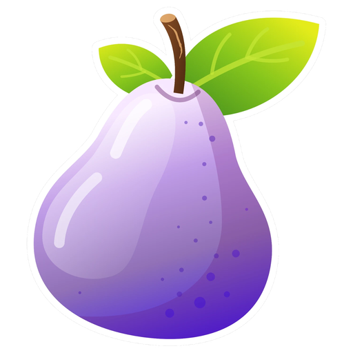

<!--
# SPDX-FileCopyrightText: Copyright 2025 Eden Emulator Project
# SPDX-License-Identifier: GPL-3.0-or-later

# SPDX-License-Identifier: GPL-2.0-or-later
-->

  

# Fritchii

Fritchii is an experimental, open-source Nintendo Switch and Switch 2 emulator written in C++, tuned for The Legend of Zelda: Ocarina of Time. Fritchii is not affiliated with Nintendo.

Fritchii is a modified version of GPL-licensed software: see [LICENSE.txt](LICENSE.txt) and the copyright notices in the source files.

## Downloads and setup

Builds are on the [releases page](https://github.com/Frizti/Fritchii/releases).

On Windows, extract the entire build archive and run **lichii.exe** (the executable keeps that name for now). Only use games and system files you have legally obtained. Games, keys and firmware are not included.

### Existing saves and settings

Fritchii keeps its own profile: `%APPDATA%\fritchii` on Windows, and the `fritchii` directories under `$XDG_DATA_HOME`, `$XDG_CONFIG_HOME` and `$XDG_CACHE_HOME` on Linux and macOS. An existing portable `user/` directory still takes priority and is not imported or changed.

On the first launch Fritchii copies your newest existing profile (an earlier Fritchii or Eden in `%APPDATA%\eden`, Lichii 150+ in `%APPDATA%\lichii`, else yuzu, suyu, sudachi or citron) into its folder and shows what it copied. Settings, keys, mods and saves are copied; caches are not, so shaders are prepared again once. The old folder is never changed. If the emulator using it is still open, close it and start Fritchii again. An interrupted copy is put back and retried on the next launch.

## Compatibility and issue reports

Compatibility and performance vary by game, hardware and driver. Rendering errors, stutters and crashes remain possible. Passing automated tests does not establish that a game renders correctly, and this project makes no universal frame-rate guarantee.

When [reporting an issue](https://github.com/Frizti/Fritchii/issues), include:

- The exact build, game version, CPU, GPU and driver version.
- Relevant settings and steps to reproduce the problem.
- A screenshot and the log from the affected session (Help > Export Log), after checking it for personal information.

Do not upload game files, keys, firmware or private account information. Questions and help: [discord.gg/fritchii](https://discord.gg/fritchii).

## Building and contributing

See the [build guide](docs/Build.md) and [coding guidelines](docs/Coding.md). Some internal build target names still use older names: the GUI build target is `yuzu`, and its output is `lichii.exe` on Windows and `lichii` on other desktop platforms.

Keep changes focused and distinguish code-level checks from actual gameplay testing.

## Artwork

The Fritchii logo, the pear (`dist/fritchii.png`, `dist/fritchii.ico`), was made for Fritchii by Freshdyno.

## Credits and license

Fritchii is a modified version of GPL-licensed software. The original copyright notices and third-party licenses are kept in the source files; see [LICENSE.txt](LICENSE.txt) for the license terms.

Dynamic FPS by Dark, bundled with his permission.

### Fritchii shader precompile recipe

The shader precompile recipes (the `*.nx2recipe` files in the `recipes` folder) were made by Frizti for Fritchii. They are not part of the GPL-licensed source code and are all rights reserved: **to use them in your own build, fork or package, you need Frizti's direct permission first. Ask Frizti by direct message on Discord.** See [LICENSES/Fritchii-Recipe.txt](LICENSES/Fritchii-Recipe.txt).

The precompile system itself (`src/video_core/nx2_precompile.*`, `src/yuzu/fritchii/precompile_gate.h`) is GPL code with additional terms under GPLv3 section 7: keep the credit "Shader precompile system by Frizti (Fritchii)", mark modified versions, and don't use the Fritchii name for other builds. See [LICENSES/Fritchii-Additional-Terms.txt](LICENSES/Fritchii-Additional-Terms.txt). If you want to use it, please ask Frizti on Discord first.
